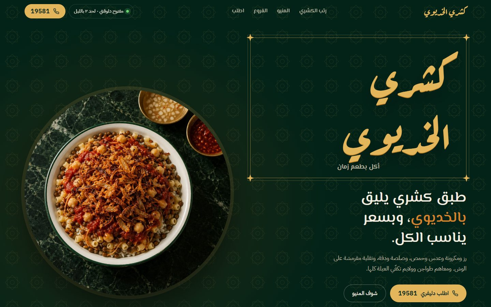
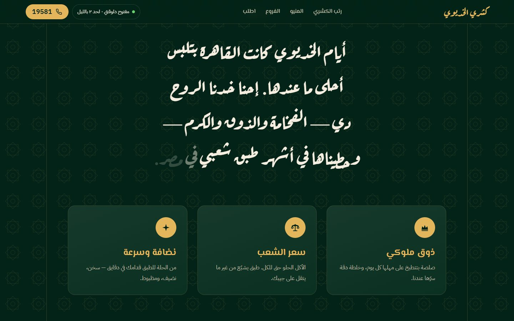
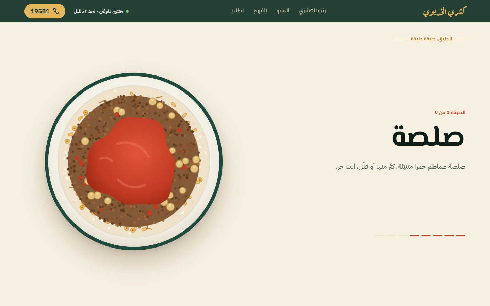
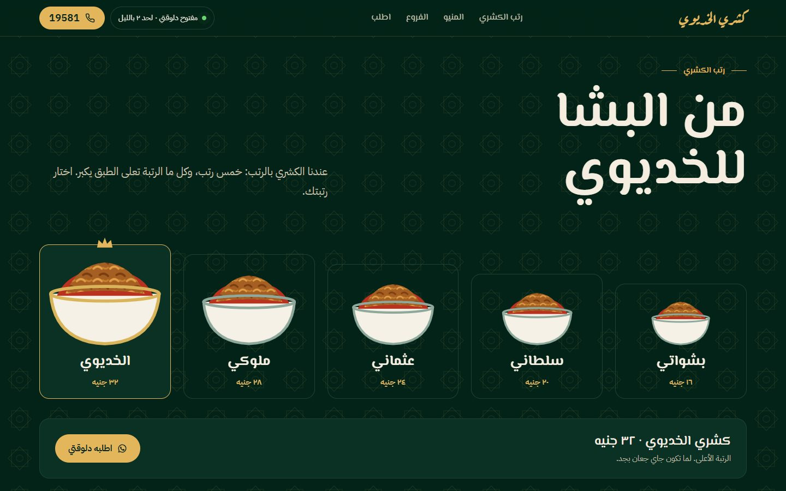
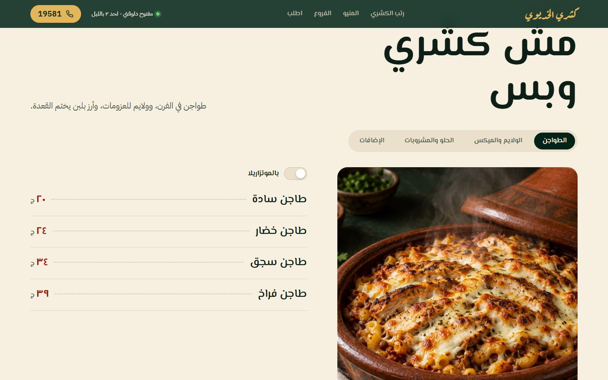
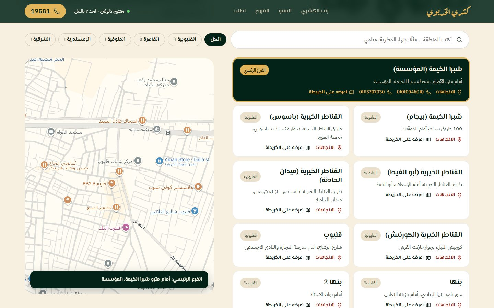
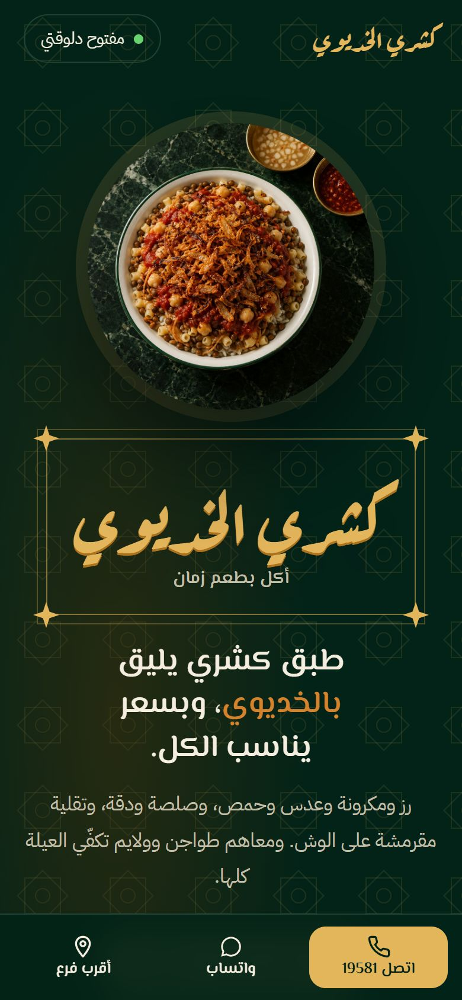
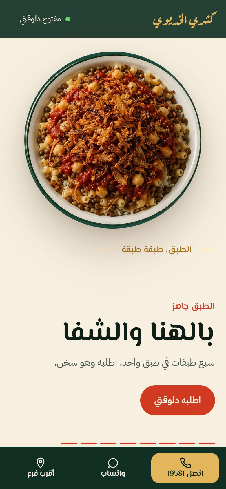
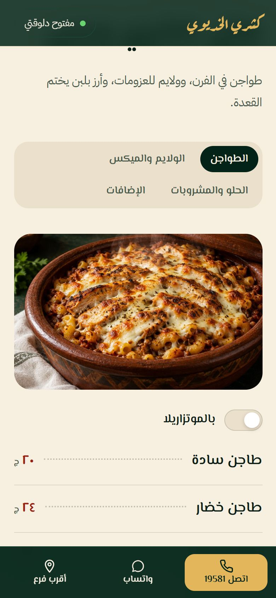

<div dir="rtl" align="right">

<h1 align="center">كشري الخديوي · أكل بطعم زمان</h1>

<p align="center">
  موقع تعريفي لسلسلة مطاعم <b>كشري الخديوي</b>: هوية مستوحاة من مصر الخديوية، وطبق كشري بيتبني طبقة طبقة مع السكرول، ومنيو كامل، و١٧ فرع على الخريطة.
</p>

<p align="center">
  <a href="https://koshary-alkhedawy.vercel.app"><b>🔗 شوف الموقع أونلاين</b></a>
</p>

<p align="center">
  
</p>

---

## نظرة سريعة

| | |
|---|---|
| **الرابط** | [koshary-alkhedawy.vercel.app](https://koshary-alkhedawy.vercel.app) |
| **اللغة** | عربي، من اليمين للشمال (RTL) |
| **التقنية** | HTML و CSS و JavaScript عادي، من غير أي framework أو build |
| **الحجم** | صفحة واحدة حوالي ٧٠ كيلوبايت، و٦ صور حوالي ١.٣ ميجا |
| **الاستضافة** | Vercel |

## الأقسام

<table>
<tr>
<td width="50%"></td>
<td width="50%"></td>
</tr>
<tr>
<td><b>الحكاية:</b> النص بيتملى بالأبيض كلمة كلمة مع السكرول، وتحته تلات كروت للقيم: ذوق ملوكي، وسعر الشعب، ونضافة وسرعة.</td>
<td><b>الطبق طبقة طبقة:</b> رسمة SVG لطبق من فوق، والمكونات بتترش فيه مع السكرول، من الرز لحد التقلية. وفي الآخر الرسمة بتتحول لصورة الطبق.</td>
</tr>
<tr>
<td></td>
<td></td>
</tr>
<tr>
<td><b>رتب الكشري:</b> الخمس أحجام بأساميهم (بشواتي، سلطاني، عثماني، ملوكي، الخديوي). العميل بيختار الحجم، وزرار "اطلبه دلوقتي" بيفتح واتساب برسالة جاهزة فيها الحجم والسعر.</td>
<td><b>المنيو:</b> tabs للطواجن والولايم والحلو والإضافات. وفي الطواجن زرار "بالموتزاريلا" بيغيّر الأسعار على طول.</td>
</tr>
</table>

<p></p>

**الفروع:** ١٧ فرع، وفيه بحث بالمنطقة وفلتر بالمحافظة. لما تدوس على أي فرع، الخريطة اللي جنبه بتروح لمكانه، وكل فرع ليه زرار اتجاهات وأرقام تليفون لو موجودة.

### على الموبايل

<p align="center">
  
  &nbsp;
  
  &nbsp;
  
</p>

على الموبايل فيه شريط ثابت تحت فيه: **اتصل 19581**، و**واتساب**، و**أقرب فرع**.

## المميزات

- **حالة المحل:** "مفتوح دلوقتي" أو "مقفول"، وبتتحسب بتوقيت القاهرة على حسب مواعيد العمل.
- **الطلب بضغطة واحدة:** اتصال بالخط الساخن، أو رسالة واتساب مكتوبة جاهزة.
- **SEO محلي:** بيانات `Restaurant` بصيغة JSON-LD فيها العنوان والإحداثيات والمواعيد، ووسوم Open Graph للمشاركة على السوشيال.
- **Accessibility:**
  - رابط "انتقل للمنيو".
  - تنقّل بالكيبورد في الـ tabs.
  - `aria` على العناصر التفاعلية.
  - احترام إعداد **تقليل الحركة**: اللي قافل الأنيميشن من جهازه بيشوف fades هادية بدل الحركة، والموقع مش بيبقى ثابت.
- **الأداء:** من غير مكتبات خارجية، والصور مضغوطة وبتتحمّل وقت الحاجة (lazy loading).

## هيكل المشروع

```
koshary-alkhedawy/
├── index.html            ← الموقع كله: HTML + CSS + JavaScript
├── images/               ← صور الموقع (6 صور JPG)
│   ├── hero-bowl.jpg
│   ├── shop-night.jpg
│   ├── tagine.jpg
│   ├── feast.jpg
│   ├── roz-bel-laban.jpg
│   └── taleya.jpg
└── docs/screenshots/     ← صور الـ README بس (مش بتترفع على الموقع)
```

## تعديل البيانات

كل بيانات المطعم في مكان واحد: الكائن `DATA` في أول الـ `<script>` جوه `index.html`. عشان تغيّر سعر أو تضيف فرع، مش محتاج تلمس أي كود تاني.

```js
var DATA = {
  hotline: "19581",
  whatsapp: "201068313156",        // رقم الواتساب بصيغة دولية من غير +
  hours: { open: 11, close: 2 },   // من 11 الصبح لـ 2 بالليل
  pricesUpdated: "سبتمبر ٢٠٢٦",

  ranks:    [ { name: "بشواتي", price: 16, note: "..." }, ... ],   // أحجام الكشري
  menu:     [ { id: "tagine", label: "الطواجن", items: [...] }, ... ],
  branches: [ { area: "...", gov: "...", addr: "...", phones: [...], mq: "...", geo: "..." }, ... ]
};
```

**حقول الفروع:**

| الحقل | معناه |
|---|---|
| `area` | اسم الفرع اللي بيظهر في الكارت |
| `gov` | المحافظة، ومنها بيتعمل فلتر المحافظات |
| `addr` | العنوان المكتوب |
| `phones` | أرقام الفرع (اختياري) |
| `geo` | إحداثيات الفرع، زي `"30.1785647,31.2139626"`. لو موجودة، الخريطة بتحط العلامة على المحل بالظبط |
| `mq` | كلمة البحث اللي الخريطة بتستخدمها لو مفيش `geo` |
| `main: true` | الفرع الرئيسي، وده اللي بيظهر على الخريطة أول ما الصفحة تفتح |

## التشغيل على الجهاز

مفيش أي خطوات build. افتح `index.html` في المتصفح على طول، أو شغّل أي سيرفر محلي:

```bash
npx serve .
# أو
python -m http.server 8000
```

## النشر

الموقع مرفوع على Vercel كموقع static، من غير أي إعدادات إضافية:

```bash
vercel deploy --prod
```

> الـ repo لسه مش مربوط بـ Vercel، يعني الرفع على GitHub مش بيحدّث الموقع لوحده. عشان أي push ينشر الموقع أوتوماتيك، اربطهم من Vercel: المشروع، وبعدين **Settings**، وبعدين **Git**، وبعدين **Connect**.

## قبل الإطلاق الرسمي

- [ ] **الصور:** الصور الحالية معمولة بالذكاء الاصطناعي، ولازم تتبدل بصور حقيقية من الفروع بنفس الأسامي جوه فولدر `images/`.
- [ ] **الأسعار:** جاية من مواقع منيو عامة، وآخر تحديث ليها سبتمبر ٢٠٢٦. لازم تتراجع مع المطعم.
- [ ] **رقم الواتساب ومواعيد العمل:** متاخدين من مصدر واحد، ومحتاجين تأكيد.
- [ ] **إحداثيات الفروع:** لازم نجيب إحداثيات كل فرع من جوجل ماب ونحطها في `geo`. دلوقتي الفرع الرئيسي بس اللي إحداثياته دقيقة.
- [ ] **الريفيوز:** لو المطعم عايز قسم تقييمات، يتضاف بريفيوز حقيقية من صفحتهم على جوجل.
- [ ] **الدومين:** لو عندهم دومين، يتربط من إعدادات **Domains** في Vercel.

## المصادر

- البيانات: [انستجرام كشري الخديوي](https://www.instagram.com/kosharyalkhedawy/)، و[menuegypt.com](https://www.menuegypt.com/ar/%D9%83%D8%B4%D8%B1%D9%8A-%D8%A7%D9%84%D8%AE%D8%AF%D9%8A%D9%88%D9%8A)، و[egyptmenu.net](https://egyptmenu.net/%D9%85%D9%86%D9%8A%D9%88-%D9%83%D8%B4%D8%B1%D9%8A-%D8%A7%D9%84%D8%AE%D8%AF%D9%8A%D9%88%D9%8A/).
- الخطوط من Google Fonts: <b>Aref Ruqaa</b> للافتة والعناوين المميزة، و<b>El Messiri</b> للعناوين، و<b>IBM Plex Sans Arabic</b> للنصوص.

</div>
